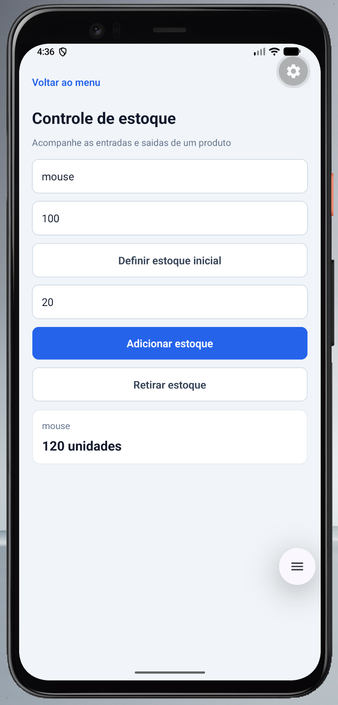
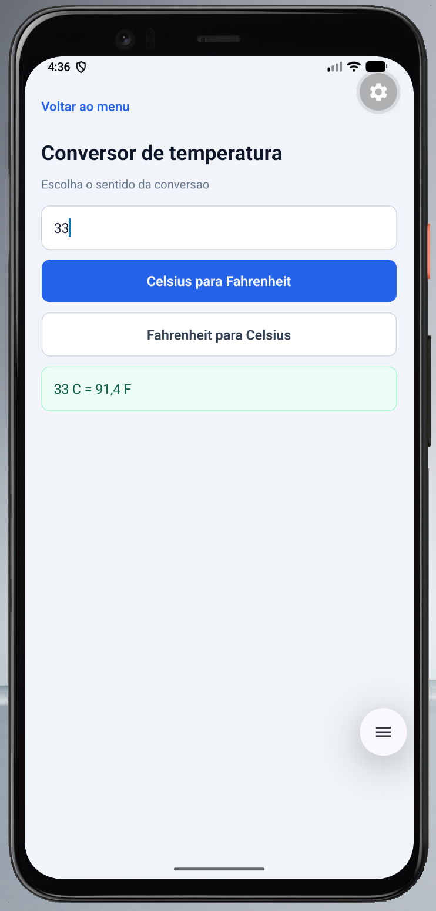
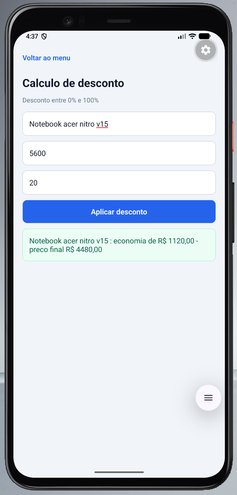

# Lista de exercícios 01 - React Native

Projeto Expo com as 9 questões da lista da disciplina de Desenvolvimento para Dispositivos Móveis, do curso de Sistemas de Informação da UFRA.

Cada questão usa `View`, `Text`, `TextInput`, `Button`, `StyleSheet` e `useState`, com as validações pedidas em cada enunciado.

## Organização do repositório

| Pasta | Para que serve |
|---|---|
| `App.js` e `questoes/` | Aplicativo único com um menu que abre cada questão |
| `snack/` | Cada questão em um arquivo só, para colar no `App.js` de um Expo Snack |
| `projetos/` | Nove projetos Expo independentes, um por questão |
| `prints/` | Capturas de tela dos aplicativos rodando |

## Questões

| Nº | Questão | Arquivo |
|---|---|---|
| 1 | Consumo diário de água, 35 mL por kg | `questoes/questao01.js` |
| 2 | Média de três notas e situação do aluno | `questoes/questao02.js` |
| 3 | Controle de estoque de um produto | `questoes/questao03.js` |
| 4 | Conversor entre Celsius e Fahrenheit | `questoes/questao04.js` |
| 5 | Simulador de conta bancária | `questoes/questao05.js` |
| 6 | Eleição com três candidatos | `questoes/questao06.js` |
| 7 | Cálculo de desconto e preço final | `questoes/questao07.js` |
| 8 | Cadastro de estudantes em cards | `questoes/questao08.js` |
| 9 | Pedido de lanchonete | `questoes/questao09.js` |

## Como rodar o aplicativo com o menu

```bash
npm install
npx expo start
```

Depois leia o QR Code com o Expo Go no celular, ou aperte `a` para abrir no emulador Android.

## Como rodar uma questão sozinha

```bash
cd projetos/questao01
npm install
npx expo start
```

## Como abrir no Expo Snack

Crie um Snack novo em snack.expo.dev, apague o conteúdo do `App.js` e cole um dos arquivos da pasta `snack/`. Eles não dependem de nenhum outro arquivo.

## Capturas de tela

### Questão 1 - Consumo diário de água


### Questão 2 - Média do estudante


### Questão 3 - Controle de estoque


### Questão 4 - Conversor de temperatura


### Questão 5 - Simulador de conta


### Questão 6 - Eleição estudantil


### Questão 7 - Cálculo de desconto


### Questão 8 - Cadastro de estudantes


### Questão 9 - Pedido da lanchonete

