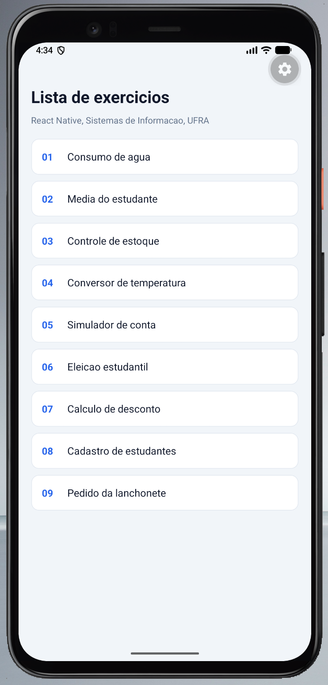
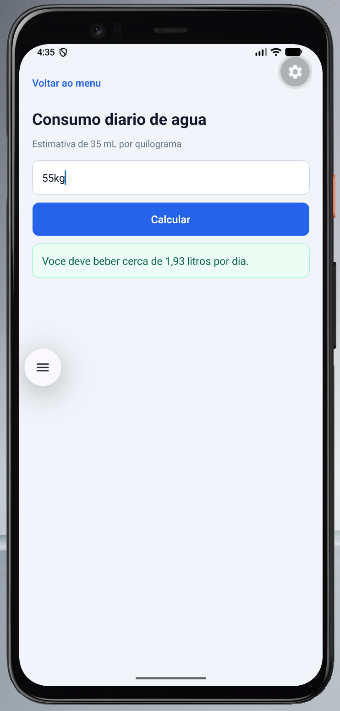
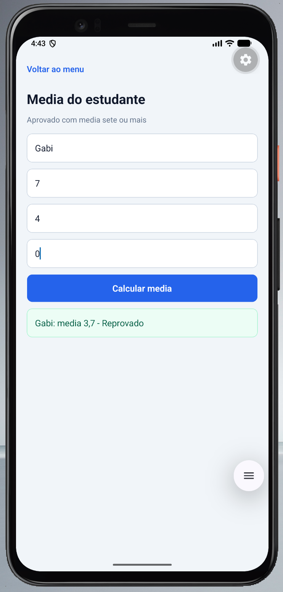
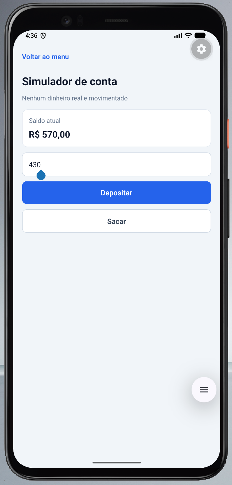
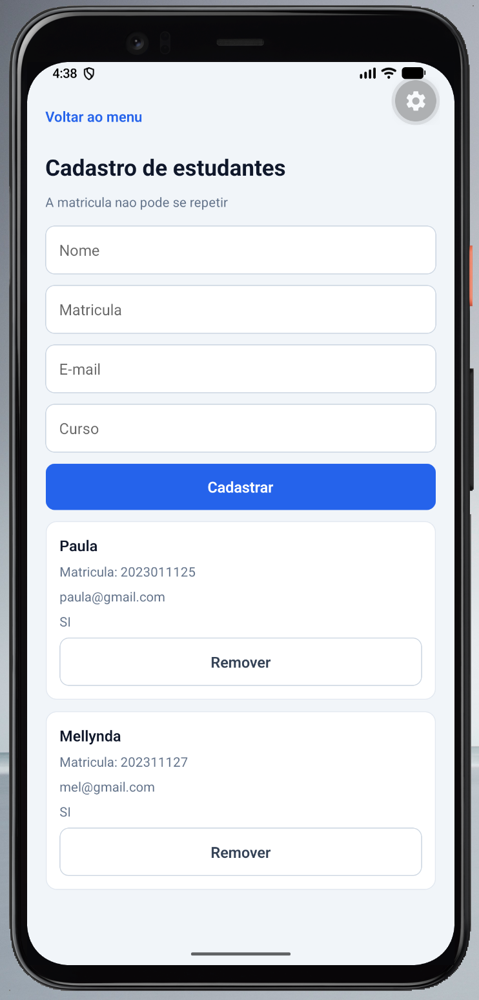

# Lista de exercícios 01 - React Native

Aplicativo Expo com as 9 questões da lista da disciplina de Desenvolvimento para Dispositivos Móveis, do curso de Sistemas de Informação da UFRA.

O `App.js` mostra um menu, e cada questão abre a partir dele. Todas usam `View`, `Text`, `TextInput`, `Pressable`, `StyleSheet` e `useState`, com as validações pedidas em cada enunciado.

## Questões

| Nº | Questão | Arquivo |
|---|---|---|
| 1 | Consumo diário de água, 35 mL por kg | `questoes/questao01.js` |
| 2 | Média de três notas e situação do aluno | `questoes/questao02.js` |
| 3 | Controle de estoque de um produto | `questoes/questao03.js` |
| 4 | Conversor entre Celsius e Fahrenheit | `questoes/questao04.js` |
| 5 | Simulador de conta bancária | `questoes/questao05.js` |
| 6 | Eleição com três candidatos | `questoes/questao06.js` |
| 7 | Cálculo de desconto e preço final | `questoes/questao07.js` |
| 8 | Cadastro de estudantes em cards | `questoes/questao08.js` |
| 9 | Pedido de lanchonete | `questoes/questao09.js` |

O arquivo `questoes/ui.js` guarda o botão e os estilos usados por todas as telas.

## Como rodar

```bash
npm install
npx expo start
```

Leia o QR Code com o Expo Go no celular, ou aperte `a` para abrir no emulador Android.

## Capturas de tela

As imagens foram tiradas no emulador Android, com o aplicativo rodando pelo Expo Go.

### Tela inicial



### Questões

|  |  |
|:--:|:--:|
| **1. Consumo diário de água**<br> | **2. Média do estudante**<br> |
| **3. Controle de estoque**<br> | **4. Conversor de temperatura**<br> |
| **5. Simulador de conta**<br> | **6. Eleição estudantil**<br> |
| **7. Cálculo de desconto**<br> | **8. Cadastro de estudantes**<br> |
| **9. Pedido da lanchonete**<br> |  |
