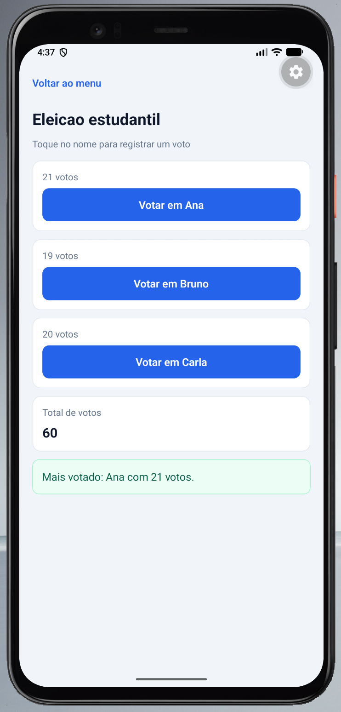
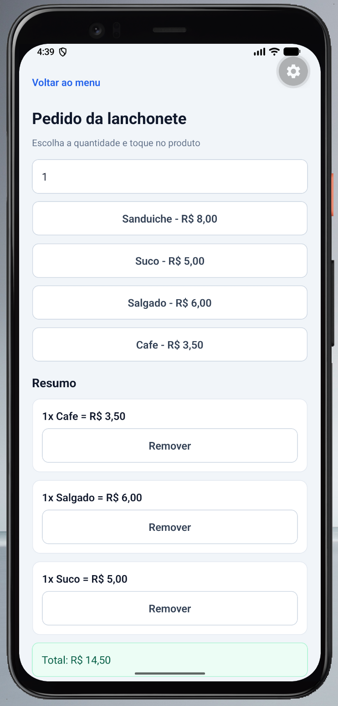

# Lista de exercícios 01 - React Native

As 9 questões da lista da disciplina de Desenvolvimento para Dispositivos Móveis, do curso de Sistemas de Informação da UFRA.

Cada questão é um projeto Expo independente dentro da pasta `projetos/`, com seu próprio `App.js`, `package.json` e README. Todas usam `View`, `Text`, `TextInput`, `Pressable`, `StyleSheet` e `useState`, com as validações pedidas em cada enunciado.

## Questões

| Nº | Questão | Projeto |
|---|---|---|
| 1 | Consumo diário de água, 35 mL por kg | `projetos/questao01` |
| 2 | Média de três notas e situação do aluno | `projetos/questao02` |
| 3 | Controle de estoque de um produto | `projetos/questao03` |
| 4 | Conversor entre Celsius e Fahrenheit | `projetos/questao04` |
| 5 | Simulador de conta bancária | `projetos/questao05` |
| 6 | Eleição com três candidatos | `projetos/questao06` |
| 7 | Cálculo de desconto e preço final | `projetos/questao07` |
| 8 | Cadastro de estudantes em cards | `projetos/questao08` |
| 9 | Pedido de lanchonete | `projetos/questao09` |

## Como rodar uma questão

```bash
cd projetos/questao01
npm install
npx expo start
```

Leia o QR Code com o Expo Go no celular, ou aperte `a` para abrir no emulador Android.

## Como abrir no Expo Snack

Crie um Snack novo em snack.expo.dev, apague o conteúdo do `App.js` e cole o `App.js` da questão. Cada arquivo é autossuficiente, não depende de nenhum outro.

## Capturas de tela

### Questão 1 - Consumo diário de água


### Questão 2 - Média do estudante


### Questão 3 - Controle de estoque


### Questão 4 - Conversor de temperatura


### Questão 5 - Simulador de conta


### Questão 6 - Eleição estudantil


### Questão 7 - Cálculo de desconto


### Questão 8 - Cadastro de estudantes


### Questão 9 - Pedido da lanchonete

