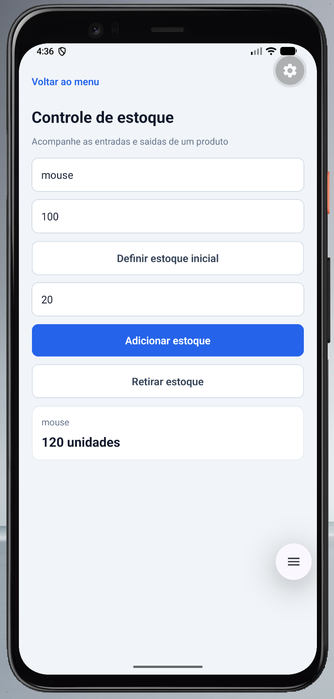

# Questão 03 - Controle de estoque

Projeto React Native com Expo, da lista de exercícios 01 da disciplina de Desenvolvimento para Dispositivos Móveis, no curso de Sistemas de Informação da UFRA.

Todo o código está no `App.js`.

## Como rodar

```bash
npm install
npx expo start
```

Leia o QR Code com o Expo Go, ou aperte `a` para abrir no emulador Android.

## Como abrir no Expo Snack

Crie um Snack novo em snack.expo.dev, apague o conteúdo do `App.js` e cole o `App.js` deste projeto. Ele não depende de nenhum outro arquivo.

## Captura de tela


